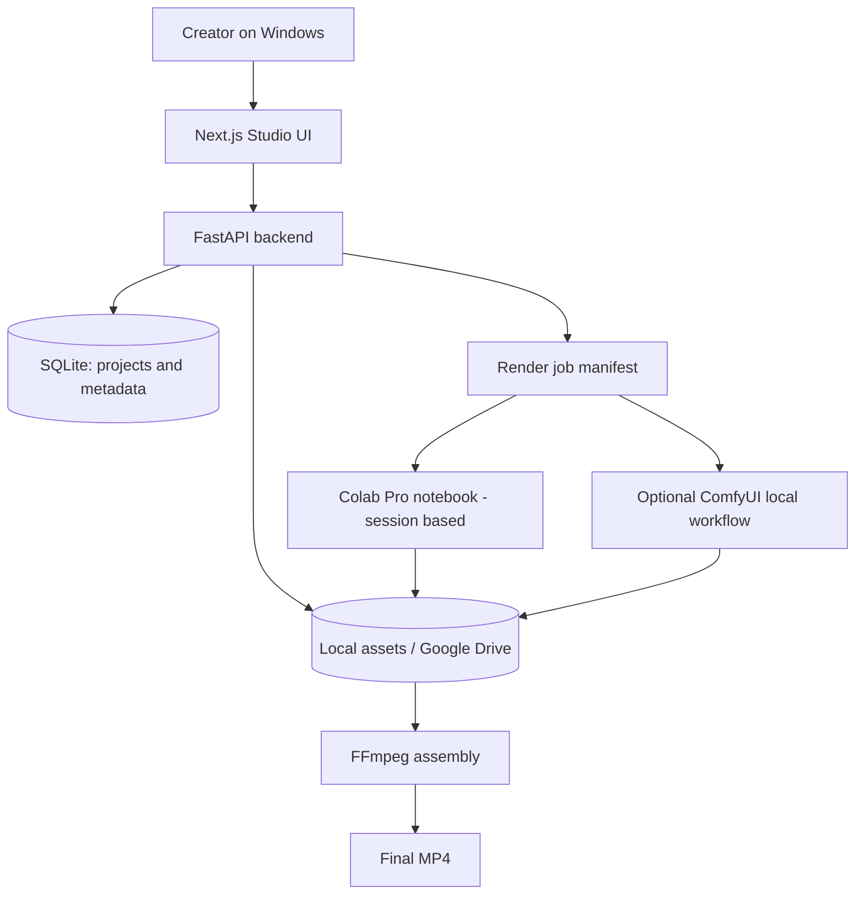

# Proposed Architecture

**Status:** Design proposal. No backend or model orchestration is implemented in this repository.

## Context diagram

## Data model (proposed)

- **Project:** id, title, language, aspect_ratio, fps, status, timestamps.
- **Episode:** id, project_id, episode_number, synopsis, duration_target.
- **Character:** id, project_id, name, physical_description, voice_profile, reference_asset_ids.
- **Scene:** id, episode_id, ordering, screenplay, duration, location, characters, shot_type, camera_move, lighting, continuity_notes.
- **Asset:** id, project_id, scene_id, kind, path, source_model, seed, generation_parameters, created_at.
- **RenderJob:** id, scene_id, model_provider, task_type, configuration, status, attempt_count, output_asset_id, error.

## Render job lifecycle

1. Validate scene and character references.
2. Serialize a **portable job manifest** (JSON) with relative asset references and desired outputs.
3. Save the job manifest durably before GPU execution.
4. Run a Colab notebook interactively; it loads an authorized manifest and its assets.
5. Save generated outputs with a new version, then update job status.
6. Inspect quality and continuity before moving to the next shot.
7. Assemble approved shots with sound and subtitles via FFmpeg.

Colab is **not** treated as an always-on API server. Sessions can expire, GPUs may change, and users must control credentials and storage access. Avoid exposing a public Colab endpoint for an unattended service.

## Key design decisions

- Prefer **SQLite** for local MVP; migrate to PostgreSQL only when collaboration/concurrency warrants it.
- Use **provider adapters** so ComfyUI, Wan and future video APIs share a stable interface.
- Preserve **asset provenance**: seeds, prompts, references, settings and model/version if available.
- Use **reproducible manifests** and versioned output filenames; do not overwrite approved scenes.
- Include **human approval gates** for visual consistency and editorial quality.
- Estimate and record **compute cost**, but do not promise fixed Colab quotas or pricing.
- Keep secrets in environment variables or platform secret stores, never in Git commits.

## Security and reliability

- Validate input file formats, sizes and paths.
- Escape or sanitize user-provided text when rendering in the UI.
- Avoid untrusted pickled checkpoints; use reputable official model sources.
- Maintain regular durable checkpoints outside ephemeral runtimes.
- Store third-party model license information alongside integrations.
