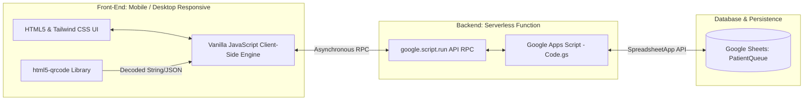
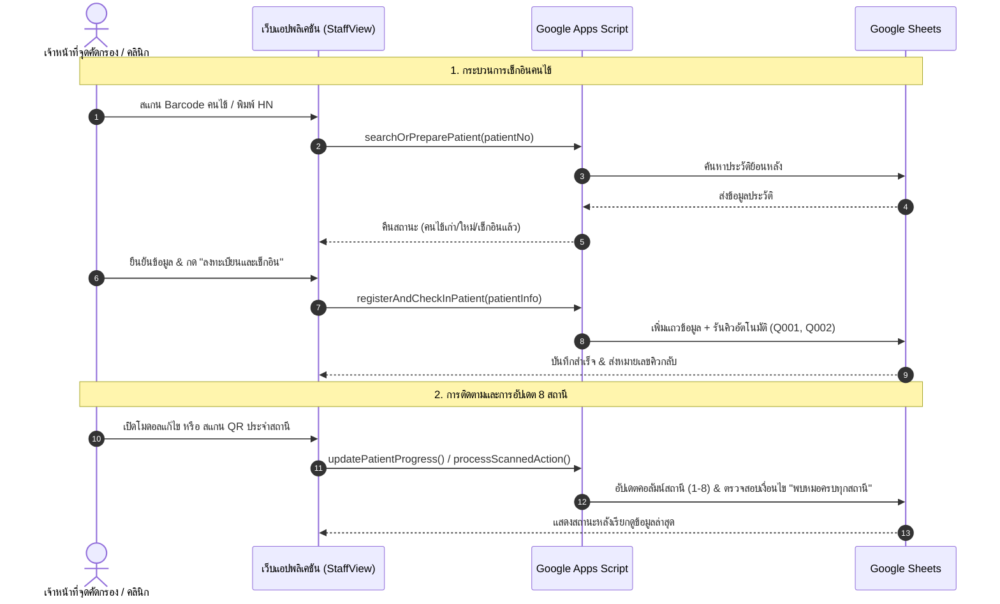

# 🏥 Outpatient Queue & Station Routing Management System

> **ขอบเขตการเผยแพร่:** เอกสารนี้เป็นกรณีศึกษาสำหรับ Portfolio โดยไม่รวมซอร์สโค้ดระบบจริง ภาพหน้าจอ เอกสารภายใน หรือข้อมูลผู้ใช้งาน ตัวอย่างข้อมูลใช้เพื่ออธิบายโครงสร้างเท่านั้น รายละเอียดการทำงานอ้างอิงคำอธิบายโครงการและยังไม่ได้ตรวจยืนยันกับระบบจริงในชุดไฟล์นี้

> **Full-Stack Web App for Clinical Operations:** ระบบบริหารจัดการคิวและติดตามขั้นตอนการตรวจคัดกรองคนไข้จากข้อมูลที่บันทึกไว้ ด้วย Google Workspace Ecosystem


---

## 📌 1. Project Overview (ภาพรวมโครงการ)

โปรเจกต์นี้ถูกออกแบบและพัฒนาขึ้นเพื่อแก้ปัญหาความล่าช้าและความผิดพลาดในการกระจายคิวคนไข้ตามจุดคัดกรอง/สถานีตรวจรักษา (8 Clinical Stations) ภายในหน่วยงานสาธารณสุข โดยเปลี่ยนกระบวนการทำงานจากระบบกระดาษและสมุดจด (Manual/Paper-based) มาเป็นระบบดิจิทัลแบบ **Serverless Web Application** เพื่อลดภาระการดูแลเซิร์ฟเวอร์แยก 

### Key Highlights
- **Fast Check-in Engine:** รองรับทั้งการค้นหาด้วยหมายเลขประจำตัวคนไข้ (HN) และการสแกน Barcode/QR Code ดึงข้อมูลประวัติคนไข้เก่าหรือขึ้นทะเบียนคนไข้ใหม่อัตโนมัติ
- **Multi-Station Tracking (8 สถานี):** ติดตามสถานะของคนไข้แต่ละรายใน 8 สถานีตรวจรักษาแบบ Granular Status (รอตรวจ / กำลังตรวจ / ตรวจเสร็จแล้ว) พร้อมระบบตรวจสอบการพบแพทย์ครบวงจร
- **Dual-Mode Barcode/QR Processing:** โหมดสแกน 2 รูปแบบ (Check-in Mode และ Station-Action Mode) ผ่านกล้องมือถือ/แท็บเล็ตโดยตรง ไม่ต้องติดตั้งเครื่องอ่าน Barcode เพิ่มเติม
- **Confirmation Controls:** ระบบยืนยันการยกเลิกเช็กอิน (Modal Confirmation) ป้องกันการลบข้อมูลคิวโดยไม่ตั้งใจ

---

## ⚙️ 2. Tech Stack & Architecture (สถาปัตยกรรมระบบ)



- **Frontend:**
  - HTML5, Vanilla JavaScript (ES6+)
  - Tailwind CSS (via CDN) เพื่อความคลีน ยืดหยุ่น และรองรับ Mobile-First Design
  - [Html5-QRCode](https://github.com/mebjas/html5-qrcode) สำหรับถอดรหัส Barcode 1D / QR Code 2D ผ่าน WebRTC Camera API
- **Backend (Serverless):**
  - Google Apps Script (V8 Runtime) ทำหน้าที่เป็น REST-like/RPC Controller
  - แนวทางควบคุมการเขียนข้อมูลพร้อมกันและการเขียนข้อมูลเป็นชุด เพื่อลดการชนกันของข้อมูลและจำนวนคำขอ ทั้งนี้ต้องตรวจสอบวิธีที่ใช้จากซอร์สโค้ดจริง
- **Database:**
  - Google Sheets (`PatientQueue`) ทำหน้าที่เป็น ตารางจัดเก็บข้อมูล

---

## 💡 3. Key Technical Challenges & Solutions (ปัญหาเชิงเทคนิคและวิธีแก้)

### 🔴 Problem 1: กล้องเลือกตัวตรวจจับผิด (Front Camera แทน Back Camera บนมือถือ)
- **Pain Point:** เมื่อเปิดกล้องบนสมาร์ทโฟนของเจ้าหน้าที่ เว็บแอปกลับเปิดกล้องหน้าทำให้เล็งสแกนเอกสารคนไข้ไม่สะดวก
- **Solution:** ปรับแต่งคอนฟิก MediaStream Constraints ให้เรียก `facingMode: "environment"` ล่วงหน้า พร้อมสร้าง Fallback Strategy หากอุปกรณ์ไม่รองรับ Constraint ดังกล่าว ให้สลับกลับมาใช้ Default Stream แทนเพื่อป้องกันหน้าจอค้าง

### 🔴 Problem 2: คอขวดของ I/O และโหลดข้อมูลค้าง (Asynchronous Loading Issue)
- **Pain Point:** ระบบ Auto-Refresh ที่พยายามดึงข้อมูลปริมาณมากทันทีที่โหลดหน้าเว็บ ก่อให้เกิดอาการโหลดคิวค้าง (Infinite Loading Spinner) เมื่อเครือข่ายมีความหน่วง
- **Solution:** 
  - ออกแบบสถาปัตยกรรมเป็น **On-Demand Data Loading** ผู้ใช้เป็นผู้ควบคุมการรีเฟรชข้อมูลผ่านปุ่ม Manual Refresh
  - ปรับปรุง Error Callback Handling ดักจับ Exception ตั้งแต่ฝั่ง Google Apps Script เพื่อให้หน้าบ้านแสดง Feedback ชัดเจน ไม่ค้างที่สถานะรอดำเนินการ

### 🔴 Problem 3: ความซ้ำซ้อนของการสแกน (UX Operational Bottleneck)
- **Pain Point:** การที่เจ้าหน้าที่หน้างานต้องกดสลับเมนูไปมาเพื่อสแกนคนไข้และเปลี่ยนสถานะทำให้เกิดขั้นตอนล่าช้า
- **Solution:** 
  - สร้างระบบจำแนกชุดข้อมูลอัจฉริยะ (Smart Payload Parsing) ใน `onScanSuccess`
  - หากได้ผลลัพธ์เป็น Plain Text (HN) -> ส่งเข้าโหมด Check-in ทันที
  - หากได้ผลลัพธ์เป็น Action Payload (JSON รูปแบบ `{"action": "update_station", "station": 1, ...}`) -> เชื่อมต่อ HN ล่าสุดและประมวลผลการเปลี่ยนสถานะทันทีใน 1 Action

---

## 📋 4. Standard Operating Procedure (SOP Workflow)



---

## 📂 5. System Structure (โครงสร้างระบบที่อธิบาย)

```text
├── Code.gs                   # Backend Logic (Controller, Database Access, QR Action Dispatcher)
├── StaffView.html            # Frontend UI, Table Renderer, QR Scanner Engine, Modal Form
├── appsscript.json           # Apps Script Manifest File (Scopes, Runtime Config)
└── README.md                 # Project Documentation & Architecture Blueprint
```

---

## 🚀 6. Installation & Deployment Guide (การติดตั้ง)

> ขั้นตอนนี้อธิบายการตั้งค่าระบบต้นทาง ซอร์สโค้ดที่อ้างถึงไม่ได้รวมอยู่ในชุด Portfolio นี้ จึงยังไม่ใช่คู่มือสำหรับติดตั้งจากไฟล์ที่เผยแพร่โดยตรง

1. เข้าไปที่ [Google Sheets](https://sheets.new) และสร้างชีตชื่อ `PatientQueue`
2. ตั้งชื่อหัวคอลัมน์ในแถวที่ 1 ตามลำดับ:
   ```text
   No. | ชื่อ | นามสกุล | อายุ | เพศ | เบอร์โทร | เลขบัตรประชาชน | หมายเหตุ | วันที่เช็กอิน | เวลาเช็กอิน | หมายเลขคิว | สถานะปัจจุบัน | ห้องตรวจที่ | สถานีที่ 1 | สถานีที่ 2 | สถานีที่ 3 | สถานีที่ 4 | สถานีที่ 5 | สถานีที่ 6 | สถานีที่ 7 | สถานีที่ 8 | พบหมอครบทุกสถานี | เวลาอัปเดตล่าสุด
   ```
3. ไปที่แถบเมนู **Extensions (ส่วนขยาย)** > **Apps Script**
4. วางโค้ด `Code.gs` และสร้างไฟล์ HTML ชื่อ `StaffView.html`
5. กด **Deploy** > **New deployment** > เลือกประเภท **Web app**
   - **Execute as:** `Me`
   - **Who has access:** จำกัดเฉพาะผู้ใช้งานที่ได้รับอนุญาตตามการตั้งค่าที่องค์กรรองรับ และตรวจสอบสิทธิ์ทุกคำขอฝั่งเซิร์ฟเวอร์
6. คัดลอก Web App URL เพื่อนำไปใช้งานบนอุปกรณ์ประจำสถานีตรวจรักษาได้ทันที

---

## 📈 7. Impact & Future Scalability

- **Managed Infrastructure:** ใช้บริการ Google Apps Script และ Google Sheets เพื่อลดภาระการดูแลเซิร์ฟเวอร์ โดยต้นทุนขึ้นอยู่กับแผนบริการและปริมาณการใช้งาน
- **High Adaptability:** โค้ดถูกจัดโครงสร้างแบบแยก Logic ชัดเจน ทำให้สามารถขยายต่อไปยัง:
  - การส่ง **Push Notification ผ่าน LINE OA (Messaging API)** เพื่อแจ้งเตือนคนไข้เมื่อใกล้ถึงคิว
  - การเชื่อมต่อ **TV Central Display** สำหรับแสดงลำดับคิวในห้องโถงพักคอย
