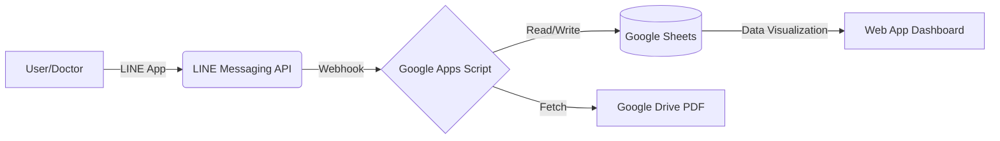

# 🏥 SiNMD Smart Clinic Assistant

> **ขอบเขตการเผยแพร่:** เอกสารนี้เป็นกรณีศึกษาสำหรับ Portfolio โดยไม่รวมซอร์สโค้ดระบบจริง ภาพหน้าจอ เอกสารภายใน หรือข้อมูลผู้ใช้งาน ตัวอย่างข้อมูลใช้เพื่ออธิบายโครงสร้างเท่านั้น รายละเอียดการทำงานอ้างอิงคำอธิบายโครงการและยังไม่ได้ตรวจยืนยันกับระบบจริงในชุดไฟล์นี้

**SiNMD Smart Clinic Assistant** คือระบบผู้ช่วยบริหารจัดการคลินิกอัจฉริยะ (Digital Transformation Project) ที่พัฒนาขึ้นเพื่อแก้ปัญหาการประสานงานแบบ Manual ลดภาระงานเอกสารของ Admin และปรับแนวทางควบคุมการเข้าถึงข้อมูลผู้ป่วย ผ่าน LINE Official Account

---

## 📌 The Problem (ปัญหาที่พบ)
* **Manual Overhead:** การแจ้งเตือนนัดหมายแพทย์ และการเช็กชื่อหน้างานใช้กระดาษและใช้เวลามาก
* **Data Leakage Risk:** การส่งเอกสารสรุปเคสคนไข้ (Case Review) ลงใน LINE Group เพิ่มความเสี่ยงที่บุคคลนอกกลุ่มผู้มีสิทธิ์จะเห็นข้อมูล
* **Logistics Issues:** ไม่ทราบจำนวนบุคลากรที่มาถึงหน้างานจริง ทำให้การคำนวณงบประมาณอาหารกลางวัน (Catering) คลาดเคลื่อน

## 🚀 The Solution (โซลูชัน)
พัฒนาระบบ Automation ครบวงจรโดยใช้ **Google Apps Script** เป็น Backend ทำงานร่วมกับ **LINE Messaging API** เพื่อสร้างประสบการณ์การใช้งานที่ราบรื่น (Seamless Experience) ให้กับอาจารย์แพทย์และบุคลากร

### ✨ Key Features (ฟีเจอร์เด่น)
1. **📲 One-time Onboarding:** ระบบลงทะเบียนผูก UserID เข้ากับชื่อและแผนกอัตโนมัติ (Identity Management)
2. **📅 Automated RSVP System:** ส่งแจ้งเตือนเชิญเข้าร่วมคลินิกล่วงหน้า พร้อมปุ่ม Flex Message ยืนยัน/ปฏิเสธนัดหมาย
3. **🔐 Targeted PDF Distribution:** คัดกรองและส่งลิงก์เอกสาร Case Review ให้ **"เฉพาะผู้ที่กดตอบรับเข้าร่วม"** และมีสิทธิ์เข้าถึงข้อมูลระดับนั้น ๆ โดยต้องตรวจสอบสิทธิ์ที่ไฟล์ปลายทางด้วย
4. **📍 Digital Check-in:** กดเช็กอินหน้างานผ่าน LINE Rich Menu พร้อมบันทึก เวลาเช็กอินลงฐานข้อมูล
5. **📊 Attendance Dashboard:** Web App แสดงรายชื่อผู้เข้าร่วมหน้างานแยกตามแผนก และสรุป KPI (RSVP Rate, Attendance Rate, No-Show)

---

## 🏗️ System Architecture (โครงสร้างระบบ)

ระบบทำงานภายใต้สถาปัตยกรรม Serverless โดยใช้บริการของ Google Workspace และ Google Apps Script:

* **Frontend (User Interface):** LINE Official Account (Flex Messages & Rich Menu)
* **Backend (Logic & Scheduler):** Google Apps Script (GAS) 
* **Database:** Google Sheets (`User_Map`, `Clinic_Schedule`, `RSVP_Log`, `Checkin_Log`)
* **File Storage:** Google Drive (สำหรับเก็บ PDF Case Review)
* **Analytics/View:** GAS Web App (HTML/CSS) สำหรับแสดงผลรายชื่อ

---

## 🛡️ แนวทางควบคุมการเข้าถึงข้อมูล (Data Access Controls)
แนวทางที่อธิบายในโครงการมีดังนี้ โดยเอกสารนี้ไม่ได้รับรองผลการตรวจด้านความปลอดภัยหรือการปฏิบัติตามกฎหมาย:
* **Role-Based Access Control (RBAC):** กรองสิทธิ์การเข้าถึงข้อมูลตามคอลัมน์ "Department"
* **Data Minimization:** เก็บเฉพาะข้อมูลที่จำเป็น (ชื่อ, แผนก, User ID)
* **Controlled Access:** ใช้ LINE Bot เป็นช่องทางรับคำขอ และกำหนดสิทธิ์ Google Drive/Sheets ให้สอดคล้องกับผู้มีสิทธิ์เข้าถึง
* **Private Delivery:** การส่งเอกสารเคสคนไข้ จะถูกส่งแบบ 1-on-1 (Private message) เท่านั้น ไม่มีการส่งลงกลุ่มสาธารณะ

---

## 📸 การแสดงผลงาน

ไม่เผยแพร่ภาพหน้าจอและเอกสารจากระบบจริง เนื่องจากมีข้อมูลภายในและข้อมูลส่วนบุคคล สามารถศึกษาลำดับการทำงานจากแผนผังในเอกสารนี้

---

## 💡 ประโยชน์ต่อกระบวนการทำงาน (Workflow Benefits)
* ⏱️ **ลดเวลาการประสานงาน (Coordination Time):** ช่วยลดขั้นตอนการติดตามคำตอบและเช็กชื่อด้วยมือ 
* 🍱 **เพิ่มความแม่นยำด้านงบประมาณ:** ใช้ข้อมูลผู้เช็กอินประกอบการวางแผนจำนวนอาหารกลางวัน
* 🔒 **ยกระดับความปลอดภัยข้อมูล:** ช่วยลดการแชร์เอกสารผิดกลุ่มด้วยการส่งข้อความรายบุคคลและการกำหนดสิทธิ์

---

## 👨‍💻 Tech Stack Detail
* **Language:** JavaScript (ES5/ES6 for GAS), HTML5, CSS3
* **APIs:** LINE Messaging API (Reply, Push, Broadcast, Multicast)
* **Services:** Google Apps Script services (SpreadsheetApp, DriveApp, HtmlService, CacheService)

---
