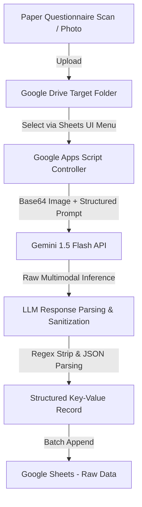

# 📋 Automated Clinical Questionnaire Digitization System

> **ขอบเขตการเผยแพร่:** เอกสารนี้เป็นกรณีศึกษาสำหรับ Portfolio โดยไม่รวมซอร์สโค้ดระบบจริง ภาพหน้าจอ เอกสารภายใน หรือข้อมูลผู้ใช้งาน ตัวอย่างข้อมูลใช้เพื่ออธิบายโครงสร้างเท่านั้น รายละเอียดการทำงานอ้างอิงคำอธิบายโครงการและยังไม่ได้ตรวจยืนยันกับระบบจริงในชุดไฟล์นี้


> An end-to-end automated pipeline using **Google Apps Script**, **Google Drive**, and **Gemini 1.5 Flash (Multimodal AI)** to automatically digitize physical clinical questionnaire forms directly into structured **Google Sheets** records.

[](https://developers.google.com/apps-script)
[](https://ai.google.dev/)
[](https://www.google.com/sheets/about/)

---

## 📌 Executive Summary

Manual data entry from clinical research questionnaires is labor-intensive, error-prone, and slow. This project provides a assisted data extraction pipeline where researchers can upload questionnaire scans/photos into Google Drive and extract data (Subject IDs, handwritten tick marks, textual options, and normalized numeric scores) directly into Google Sheets using multimodal LLMs, with extracted records reviewed before use.

---

## 💡 The Engineering Challenge & Architectural Pivot

### Phase 1: Traditional OCR Approach (Google Cloud Vision API)
Initially, the pipeline utilized traditional OCR (`DOCUMENT_TEXT_DETECTION`) combined with spatial coordinate matching ($X, Y$ bounding boxes):
* **Challenges Encountered:**
  * Inability to reliably detect whether an empty checkbox (`☐`) was checked (`✓`, `x`, or filled).
  * Checkboxes were frequently misread as arbitrary characters (`Q`, `D`, `0`, `O`).
  * High variance in camera angles, offsets, and mobile scans caused hardcoded coordinate heuristics to break.

### Phase 2: Multimodal LLM Approach (Gemini 1.5 Flash API)
To overcome the physical variations and spatial matching limitations, the pipeline was re-architected to use **Gemini 1.5 Flash**:
* **Direct Image Understanding:** Multimodal reasoning is used to interpret checked and unchecked boxes across varied image conditions; ambiguous results require review.
* **Structured JSON Generation:** Zero-shot entity extraction directly outputs normalized JSON records matching target spreadsheet schemas.
* **Robust JSON Sanitization:** A regular-expression cleanup step removes Markdown code fences and unwanted control characters before parsing. Truncated or malformed JSON requires validation and retry or manual review.

---

## 🚀 Key Features

* **Custom Google Sheets UI:** Embedded spreadsheet menu allowing users to select files directly from designated Google Drive folders.
* **Intelligent Entity Recognition:**
  * Dynamic extraction of `Subject NB` / `Subject Code` (e.g., `009`, `DEMO`).
  * Automated question itemization ($Q_1$ to $Q_{10}$).
  * Selected label identification (`(1)`, `(2)`, `(3)`, `(4)`).
  * Natural text mapping (e.g., *"ค่อนข้างเห็นด้วย"*).
  * Automated Likert score assignment (e.g., $(1)=4, (2)=3, (3)=2, (4)=1$).
* **Safe Output Parsing Pipeline:** String cleanup reduces formatting-related parsing errors. Generated JSON and score mappings still require validation.

---

## 🏗️ Architecture & Pipeline Flow



---

## 📊 Google Sheets Schema

Data is flattened and automatically appended with a timestamp:

| Column | Header | Example | Description |
| :---: | :--- | :--- | :--- |
| **A** | `Timestamp` | `2026-10-21 10:30:00` | Automated execution timestamp |
| **B** | `File ID` | `EXAMPLE_FILE_ID` | Source Google Drive File ID |
| **C** | `Subject NB` | `009` | Volunteer / Subject identifier |
| **D** | `Q1_TextAnswer` | `ค่อนข้างเห็นด้วย` | Selected option string for Question 1 |
| **E** | `Q1_Score` | `3` | Normalized Likert score for Question 1 |
| **F** | `Q2_TextAnswer` | `เห็นด้วย` | Selected option string for Question 2 |
| **G** | `Q2_Score` | `4` | Normalized Likert score for Question 2 |
| ... | ... | ... | ... |
| **V** | `Q10_TextAnswer` | `ค่อนข้างเห็นด้วย` | Selected option string for Question 10 |
| **W** | `Q10_Score` | `3` | Normalized Likert score for Question 10 |

---

## 🛠️ Installation & Setup

> ขั้นตอนนี้อธิบายการตั้งค่าระบบต้นทาง ซอร์สโค้ดที่อ้างถึงไม่ได้รวมอยู่ในชุด Portfolio นี้ จึงยังไม่ใช่คู่มือสำหรับติดตั้งจากไฟล์ที่เผยแพร่โดยตรง

1. **Prerequisites:**
   * Google Workspace Account (Google Drive & Google Sheets).
   * Google AI Studio API Key ([aistudio.google.com](https://aistudio.google.com/)).

2. **Apps Script Deployment:**
   * Open target Google Sheet $\rightarrow$ **Extensions** $\rightarrow$ **Apps Script**.
   * Copy and paste `Code.js` into the script editor.
   * Configure project variables:
     ```javascript
     const GEMINI_API_KEY = PropertiesService.getScriptProperties().getProperty('GEMINI_API_KEY');
     const SPREADSHEET_ID   = 'YOUR_SPREADSHEET_ID';
     const SHEET_NAME       = 'Raw Data';
     const TARGET_FOLDER_ID = 'YOUR_GOOGLE_DRIVE_FOLDER_ID';
     ```
   * Save and Authorize permissions (`DriveApp`, `UrlFetchApp`, `SpreadsheetApp`).

3. **Usage:**
   * Refresh the Google Sheet.
   * Access the custom menu: **ประมวลผลแบบสอบถาม** $\rightarrow$ **เลือกรูปภาพจากโฟลเดอร์ที่กำหนด**.
   * Enter the number corresponding to the target image and run.

---

## 🛡️ Error Handling & Defensive Engineering

* **Unicode/Control Character Sanitization:**
  Removes unwanted control characters before parsing to reduce `SyntaxError: Unexpected token` during JSON parsing.
* **Failsafe JSON Delimiter Discovery:**
  Dynamically extracts payloads between the first `{` and last `}` in case the LLM appends conversational disclaimers.
* **Graceful Degradation:**
  Unmarked questions or ambiguous check marks yield `null` values instead of failing the execution pipeline.

---

## 📈 ประโยชน์ของแนวทาง (Expected Benefits)

* **Turnaround Reduction:** Reduces repeated manual transcription steps; timing benchmarks are not included in this portfolio.
* **Managed Infrastructure:** Uses Google Apps Script without a separately managed server; service quotas and API costs depend on usage and account configuration.
* **Higher Data Accuracy:** Uses automated score mapping to reduce manual transcription, with human review for uncertain outputs.
> **Model version:** Gemini 1.5 Flash is the version described in the original project. Current model availability and compatibility have not been verified in this portfolio.

> **การตั้งค่าความลับ:** เก็บ API key หรือ access token ใน Script Properties ของ Apps Script ไม่ใส่ค่าจริงลงในเอกสารหรือ Git และจำกัดสิทธิ์ผู้แก้ไขโปรเจกต์
